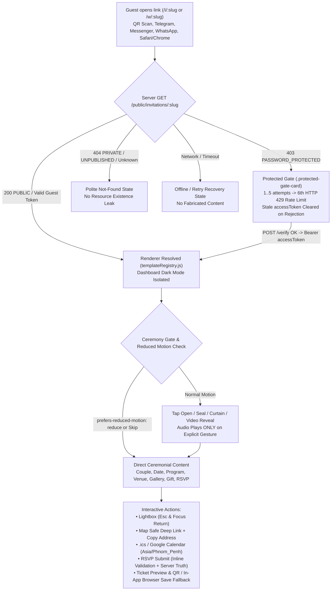

# Phase 16 Guest Journey, Interaction Design, UX Laws & Reference Evaluation

**Date:** 2026-11-27 (`UTC+07:00`)  
**Phase:** `Phase 16 — Entire guest-facing invitation / player experience`  
**Selected Skills (per `.agents/ROUTER.md`):**
- **Primary Skill:** `koupreng-qa-release` (risk-based browser/accessibility/contract gate verification)
- **Supporting Skills (2 max):** `koupreng-premium-ux` (Cambodian ceremonial choreography, Khmer typography, isolated template art direction), `wcag-audit-patterns` (WCAG 2.2 AA reflow, contrast, reduced-motion, keyboard/focus restoration)

---

## 1. End-to-End Guest Journey & Interaction Flow

---

## 2. Phase 16 Interaction & Polish Implemented (`PR #41` + `PR #42`, Preserved on `46887ac9`)

Inspected across diff `c4e4a10a..46887ac9` (`40` files in `PR #42` + `PR #41` openings):
1. **Ceremonial Opening Parity & Reduced-Motion Simplification (`WithJoyPortalOpening.jsx`, `BlissEditorialOpening.jsx`, `RibbonOpening.jsx`, `TemplateOpeningGate.jsx`, `CinematicOpeningProvider.jsx`):**
   - `WithJoyPortalOpening` and `BlissEditorialOpening` provide 1-tap reveal, explicit `Skip opening` / `រំលងការបើក` button, Escape key dismissal, and full DOM bypass (`return null`) when `prefers-reduced-motion: reduce`, `preview`, or `showOpening: false` is set.
   - `CinematicOpeningProvider` checks `reduced` and `navigator.connection?.saveData === true` before invoking video modals; `TemplateOpeningGate` gracefully falls back to `TemplateImage` when video fails or reduced-motion is requested.
2. **Audio & Media Consent (`TemplateMusicControl.jsx`, `FloatingAudioPlayer.jsx`, `FloatingActionBar.jsx`):**
   - Zero forced unmuted autoplay; playback requests originate inside explicit user click handlers with visible toggle state (`aria-pressed` / Play/Mute labels) and mobile bottom-dock clearance so sticky buttons do not cover RSVP submit controls (`FloatingActionBar.jsx` + `FloatingAudioPlayer.css`).
3. **Venue, Map, Calendar & Gallery (`TemplateVenue.jsx`, `invitationFeatures.js`, `BlissEditorialLayout.jsx`, `WithJoyPortalLayout.jsx`):**
   - Safe map link validation (`safeDirections`, `safeExternalHref`), clipboard address copy with clear feedback, Asia/Phnom Penh calendar export, and accessible lightbox dialogs with keyboard close (`Escape`) and `maxGalleryCount` cap normalization (`templateModel.js`).
4. **Public RSVP, Ticket Access & In-App Browser Support (`PublicRsvpForm.jsx`, `PublicTicketAccess.jsx`, `TicketActions.jsx`, `telegramWebApp.js`):**
   - Handles both general RSVP and token-scoped personalized RSVP (`?token=`), blocks double submits while pending, clears stale `accessToken` on 403/rejection, renders server-returned ticket QR (`KPR-...`) after server acceptance, and detects in-app user agents (`Telegram` WebApp / iOS / Android in-app fallback guidance in `TicketActions.jsx` without blocking desktop/mobile browsers).
5. **Graceful Error Boundaries & States (`PublicInvitationFeature.jsx`, `RouteErrorBoundary.jsx`):**
   - Explicit rendered states for `404` (`PRIVATE` / `UNPUBLISHED` / unknown slug), `403` (`PASSWORD_PROTECTED` form), `429` (rate-limit cooldown messaging), offline/network abort (retry button), and React render error fallback (`TemplateRenderGuard.jsx`).

---

## 3. UX Laws & WCAG 2.2 Traceability Matrix

| Principle | Guest Task | Affected Route / Component | Implemented Behavior | Test / Verification Evidence | Remaining Limitation |
|---|---|---|---|---|---|
| **Jakob’s Law** | Navigate invitation sections & RSVP predictably | `/i/:slug`, `GuestSectionNavigation.jsx`, `TemplateQuickNav.jsx`, `PublicRsvpForm.jsx` | Standard section anchors (`#story`, `#schedule`, `#venue`, `#gallery`, `#rsvp`) + recognizable RSVP Attend/Decline/Unsure radios & submit CTA | `phase12-matrix.spec.js`, `royal-garden-mobile-navigation.spec.js`, `PublicGuestExperience.test.jsx` | Physical phone thumb-reach comfort untested (`BLOCKED_EXTERNAL`) |
| **Hick–Hyman Law** | Reach key date/venue/RSVP without hunting through animations | `TemplateOpeningGate.jsx`, `WithJoyPortalOpening.jsx`, `BlissEditorialOpening.jsx` | Visible primary `Open` CTA + prominent `Skip opening` button; 1-tap unlock avoids multi-screen wizards | `guestCeremonyOpenings.test.jsx`, `phase16RendererParity.test.jsx` | Legacy `invitation-styles-v2.spec.js` test still looks for opener under reduced motion |
| **Fitts’s Law** | Tap open, navigation, map, RSVP & ticket buttons cleanly on mobile | `FloatingActionBar.jsx`, `FloatingAudioPlayer.css`, `digital-yes.css`, `bliss-editorial.css`, `withjoy-portal.css` | Generous touch buttons (`min-height >= 40-44px` on primary controls) and safe-area bottom dock insets (`env(safe-area-inset-bottom)`) | `capture-phase16-evidence.mjs` (`0px` overflow at `320px` & `390px`), `royal-garden-mobile.config.js` | Hardware iOS Safari bottom toolbar dynamic shrink untested on real device |
| **Miller’s Law** | Digest family elders, multi-day Khmer ceremonies, venue & FAQ | `KhmerFloralGoldLayout.jsx`, `CanvaKhmerWeddingTemplate.jsx`, `EmeraldLuxeLayout.jsx`, `TemplateSchedule.jsx` | Content grouped into discrete semantic sections (Hero, Couple/Parents, Save-the-Date, Morning/Evening Schedule, Venue, Gallery, Gift, RSVP) | `capture-phase16-evidence.mjs` across all 14 renderer/alias views | Very long custom user bios > 1,000 chars depend on author copy editing |
| **Tesler’s Law** | Unlock password gates & resolve tokenized guest identity cleanly | `PublicInvitationFeature.jsx`, `httpClient.js`, `PublicTicketAccess.jsx` | Client automatically attaches & clears stale `accessToken` on 403 rejection, preserves `?token=` guest scope, formats `.ics` timezone | `phase15PublishingAccess.test.jsx`, `PublicGuestExperience.test.jsx`, `httpClient.test.js` | Pre-rotation `accessToken` remains valid server-side until TTL expiry |
| **Doherty Threshold** | See immediate loading/saving/opening state without frozen screen | `PublicInvitationFeature.jsx`, `WithJoyPortalOpening.jsx`, `PublicRsvpForm.jsx`, `PageSkeleton` | Localized loading skeleton (`កំពុងផ្ទុកសន្លឹកការ…`), instant reduced-motion bypass, disabled pending buttons during POST | `PublicGuestExperience.test.jsx`, `PublicRsvpForm.test.jsx` | Live mobile 3G/4G TTFB latency unmeasured against production CDN |
| **Gestalt Principles** | Distinguish ceremonial sections, schedule days, and interactive inputs | All renderer CSS (`khmer-celestial.css`, `silk-heritage.css`, `bliss-editorial.css`, `withjoy-portal.css`) | Clear visual figure-ground separation between ornamental frames, timeline cards, and high-contrast form fields | `capture-phase16-evidence.mjs` screenshots `01..20` (`axe=0` contrast & structure) | Manual color-blind / low-vision review recommended before v1.0 launch |
| **Aesthetic–Usability Effect** | Experience bespoke Cambodian luxury identity across templates | `templateRegistry.js`, individual layout CSS files | Every template preserves distinct typography/palette isolated from host Obsidian Dark Mode (`dashboardTheme='dark'` verified) | `capture-phase16-evidence.mjs` case `19` (`silk-heritage` stays heritage light under dark localStorage) | Video/audio bandwidth depends on couple's uploaded media size |
| **Von Restorff Effect** | Spot the primary invitation action (`Open Invitation` / `Confirm RSVP`) | `TemplateOpeningGate.jsx`, `PublicRsvpForm.jsx` | Single primary gold/champagne button stands out over quiet secondary skip/navigation actions | `06-before-after-visual-evidence.md` | — |
| **Peak–End Rule** | Memorable arrival & trustworthy RSVP + Ticket QR handoff | `WithJoyPortalOpening.jsx`, `TicketActions.jsx`, `PublicTicketAccess.jsx` | Smooth reveal at start; server-confirmed RSVP summary + downloadable QR ticket + in-app browser fallback at end | `TicketActions.test.jsx`, `guest-ticket-polish.spec.js`, `capture-phase16-evidence.mjs` case `24` | Native iOS/Android in-app share sheet saving requires physical device test |
| **Nielsen’s 10 Heuristics** | Status visibility, Khmer real-world convention, error recovery, freedom | `PublicInvitationFeature.jsx`, `ProtectedGate`, `RouteErrorBoundary.jsx` | Bilingual KH/EN copy, `Skip opening` control, polite 404/403/429/offline retry recovery without technical jargon | `capture-phase16-evidence.mjs` cases `21..23`, `batch12-core-hardening.spec.js` | Manual VoiceOver/TalkBack screen-reader pass not yet executed |

---

## 4. Design Research, StyleSeed Status, UI/UX Pro Max & Ten-Library Evaluation

### 4.1 StyleSeed Status (Checked on Workspace)
- Inspected `.styleseed/project.json` and `.styleseed/artifacts/index.json` -> **both `False` (absent)**. Per project rules, StyleSeed artifacts/scores were **not** invented; Koupreng project skills (`koupreng-qa-release`, `koupreng-premium-ux`, `wcag-audit-patterns`) and `ui-ux-pro-max` were used directly.

### 4.2 Verbatim `ui-ux-pro-max` Search Executions (2026-11-26)
Saved raw session log: `steps/119/output.txt` (`exit code 0`):
1. `python .agents/skills/ui-ux-pro-max/scripts/search.py "wedding guest invitation mobile experience" --domain ux`
   - **Returned 3 UX guidelines (`ux-guidelines.csv`):**
     1) *Forms / Mobile Keyboards*: use appropriate `inputmode` (`inputmode='numeric'` for guest counts/phones). Informed verification of numeric stepper & attendee inputs in `PublicRsvpForm.jsx`.
     2) *Responsive / Mobile First*: mobile base CSS first, progressive breakpoints. Verified across `320px`, `390px`, `430px`, `768px`, `1440px`.
     3) *Touch / Pull to Refresh*: use `overscroll-behavior: contain` on overlays/drawers so ceremonial scenes don't accidentally reload the page on mobile scroll.
2. `python .agents/skills/ui-ux-pro-max/scripts/search.py "Khmer bilingual typography responsive" --domain typography`
   - **Returned 3 entries (`typography.csv`):** *Bold Typography Mobile (Inter Poster)* (`Inter` + `Playfair Display` + `JetBrains Mono`), plus non-Latin font sizing/line-height guidance (`Hebrew Modern`, `Arabic Elegant`). Informed verifying existing Koupreng Khmer font stack (`Moul` / `Bayon` / `Kantumruy Pro` / `Noto Sans Khmer`) preserves loose line-height without clipping Khmer vowel marks or subscript consonants.
3. `python .agents/skills/ui-ux-pro-max/scripts/search.py "Cambodian luxury wedding invitation" --design-system`
   - **Returned design profile:** *Hero + Testimonials + CTA*, *Soft UI Evolution*, pre-delivery checklist requiring SVG icons (Lucide, zero default emoji icon system), smooth `150–300ms` transitions, contrast `>= 4.5:1`, visible focus states, strict `prefers-reduced-motion`, and responsive checks across `375px`, `768px`, `1024px`, `1440px`. Note: generic pink palette returned by generic query (`#DB2777`) was **rejected** in favor of Koupreng's verified `MASTER_SCOPE.md` & Obsidian/Champagne + bespoke per-template cultural palettes.

### 4.3 Interaction & Cambodian Market Reference Notes
- **Interaction references (`60fps.design`, `lawsofux.com`, `motion.dev`):** Studied 1-tap progressive reveals, non-trapping lightboxes, reduced-motion instant skips, and safe mobile bottom docks. Zero proprietary assets or third-party templates were copied.
- **Cambodian invitation ecosystem references (`saambot.com`, `sarserei.com`, `khinvite.com`, `planessential.com`):** Referenced structurally for Cambodian ceremony terminology (morning procession/Pithi Hae Chomnoun, Khmer lunar/solar date phrasing, bilingual English/Khmer switch, KHQR wedding gift expectations, Telegram/Messenger in-app share opens) — confirming Koupreng distinguishes a full event-management workspace + isolated per-template guest player cleanly while avoiding insecure direct WhatsApp/Telegram scraping or hardcoded copy. *(`sambot.online` noted in prompt as unverified — not relied upon.)*

### 4.4 Mandatory Ten React UI Libraries / Reference Evaluation (Zero New Dependencies Added)

| # | Library | Phase 16 Disposition | Pattern Inspected & Technical Rationale | Package / Bundle Impact | License & Redistribution Notes |
|---|---|---|---|---|---|
| 1 | **Animate UI** | `Inspected / Inspiration Only` | Ceremony reveal timing concepts adapted as lightweight CSS keyframes + Framer Motion `opacity/transform` (`WithJoyPortalOpening`, `BlissEditorialOpening`) | `0` bytes added | Zero upstream source copied |
| 2 | **Badtz UI** | `Inspected / Inspiration Only` | Structured invitation section cards & metadata pill proportions | `0` bytes added | Original CSS tokens |
| 3 | **Lightswind UI** | `Inspected / Rejected` | Decorative glow effects avoided inside high-density guest forms/readability paths | `0` bytes added | Rejected heavy effects |
| 4 | **Kokonut UI** | `Inspected / Inspiration Only` | Minimal guest action dock spacing; built natively with Tailwind CSS Grid/Flexbox | `0` bytes added | Zero dependency |
| 5 | **Untitled UI React** | `Inspected / Adapted as Original Code` | Clean dialog header/spacing & accessible RSVP error summary geometry | `0` bytes added | Original React components (`Modal.jsx`, `PublicRsvpForm.jsx`) |
| 6 | **shadcn/ui** | `Preserved & Adapted` | Existing repo Radix/accessible primitive conventions (`Modal.jsx`, `ConfirmDialog.jsx`, focus restoration) preserved cleanly | `0` bytes added | Compatible MIT architectural pattern |
| 7 | **React Bits** | `Inspected / Rejected for Runtime` | Avoided kinetic text/particle JS runtimes that degrade low-end mobile phones & violate `prefers-reduced-motion` | `0` bytes added | Commercial redistribution concerns noted in Phase 13; unused |
| 8 | **Aceternity UI** | `Inspected / Rejected for Guest Canvas` | 3D spatial inspiration only; existing `Card3DFlip` uses lightweight CSS transforms rather than WebGL/Aceternity bundles | `0` bytes added | Zero heavy shader/runtime overhead |
| 9 | **Magic UI** | `Inspected / Inspiration Only` | Subtle gold shimmer inspiration strictly gated under `prefers-reduced-motion: no-preference`; existing countdown uses plain accessible `<time>`/`<strong>` | `0` bytes added | Original CSS |
| 10 | **Skiper UI** | `Inspected / Inspiration Only` | Slide-up mobile drawer / ticket sheet sheet feel; implemented natively with CSS transitions | `0` bytes added | Original code |
