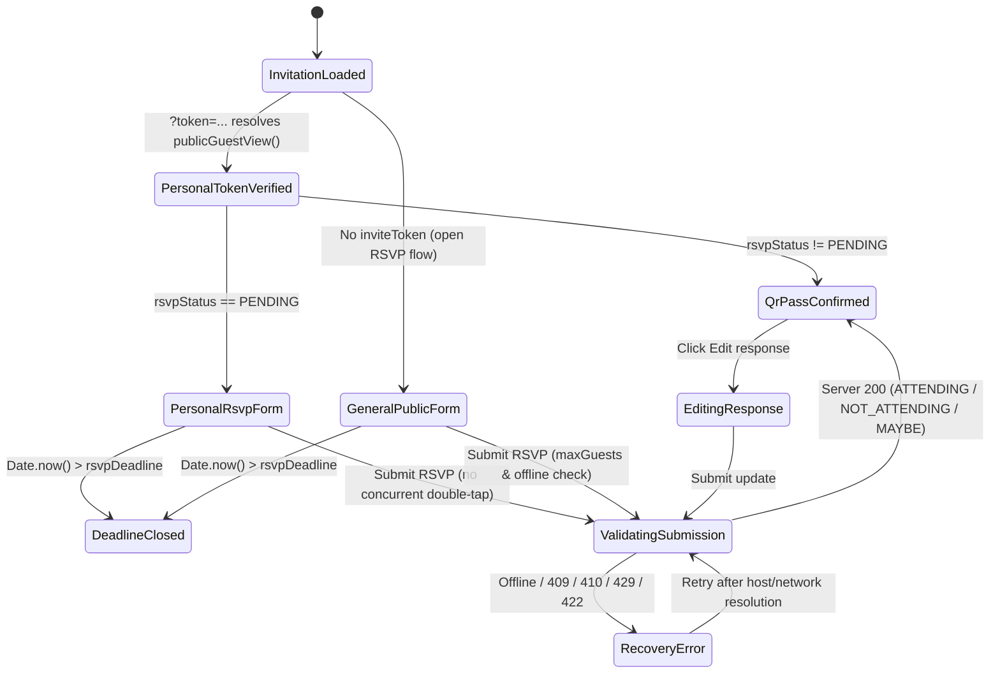

# Phase 18 — RSVP Lifecycle & Interaction State Architecture

**Phase:** 18 — RSVP lifecycle, guest interaction, wishes and privacy  
**Worktree:** `D:\Koupreng-Phase18-worktree` (`feat/phase18-rsvp-lifecycle`)  
**Base Verified SHA:** `84a9fb990ac2e2f3fdcb123286244d645cd50716` (`PR #44`)

## 1. End-to-End RSVP Lifecycle Flow

## 2. Core Flows Preserved & Enhanced

- **Verified Personalized RSVP (`inviteToken`):** Resolves `invitationService.publicGuestView`, pre-populates guest identity/seats, offers Telegram RSVP reminder handoff (`t.me`), shows immediate QR pass confirmation when already answered, and suppresses misleading `localStorage` fallback authority on token verification failure.
- **General Public RSVP (`!inviteToken`):** Clearly labels open form scope, displays `rsvpDeadline` and `maxGuests` hints when configured, validates count ceilings before network request, sets `attendeeCount: 0` automatically on `NOT_ATTENDING`, and saves server confirmation receipt + QR pass URL.
- **Public Wishes Policy Preserved:** Calls `rsvpService.publicWishes`; renders nothing (`null`) when backend returns `[]` by privacy policy. Zero fabricated or local-only public wishes are generated.
