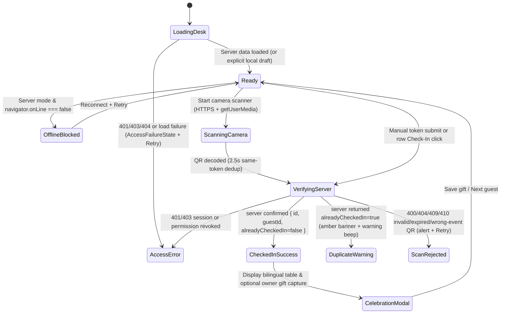

# Phase 20 — Check-In Desk State Diagram & Negative Scenario Matrix

**Modules:** [`InvitationCheckInPage.jsx`](file:///D:/Koupreng-Phase20-worktree/apps/frontend-user/src/features/invitations/InvitationCheckInPage.jsx), [`useCheckInDesk.js`](file:///D:/Koupreng-Phase20-worktree/apps/frontend-user/src/features/invitations/hooks/useCheckInDesk.js), [`QrCameraScanner.jsx`](file:///D:/Koupreng-Phase20-worktree/apps/frontend-user/src/features/invitations/components/QrCameraScanner.jsx)

## Negative Scenario Verification Summary
- **Camera permission denied (`NotAllowedError`):** Surfaces localized browser permission recovery prompt with direct manual lookup fallback.
- **No camera / insecure non-HTTPS origin:** Explicitly reports non-HTTPS or missing `mediaDevices.getUserMedia` support without breaking manual desk or roster lookup.
- **In-app WebView camera restrictions:** `isInAppBrowser()` surfaces proactive guidance to open in Safari/Chrome or use manual lookup.
- **Stale camera verification / burst duplicate frames:** `detectLoop` awaits `onScanRef.current(token)` before clearing `isVerifying` and enforces a `2500ms` identical-token debounce.
- **Duplicate check-in (`alreadyCheckedIn`):** Renders distinct high-contrast `.checkin-duplicate-banner` (`role="alert"`) with timestamp and source plus accessible dismiss control (`aria-label`).
- **Invalid / expired / wrong-event QR:** Routed to `.checkin-scan-outcome--invalid` (`role="alert"`) with exact server message and `Retry` button, leaving check-in desk operational.
- **Network disconnect (`OFFLINE`):** Server-backed invitations explicitly refuse offline attendance recording (`Live server verification required`) — never silently falling back to local storage.
- **Unauthorized collaborator (`!MANAGE_CHECKIN`):** Displays `.checkin-readonly-banner` (`role="status"`), disables camera start, scan submit, manual row buttons, and hides `Remove` undo buttons.
